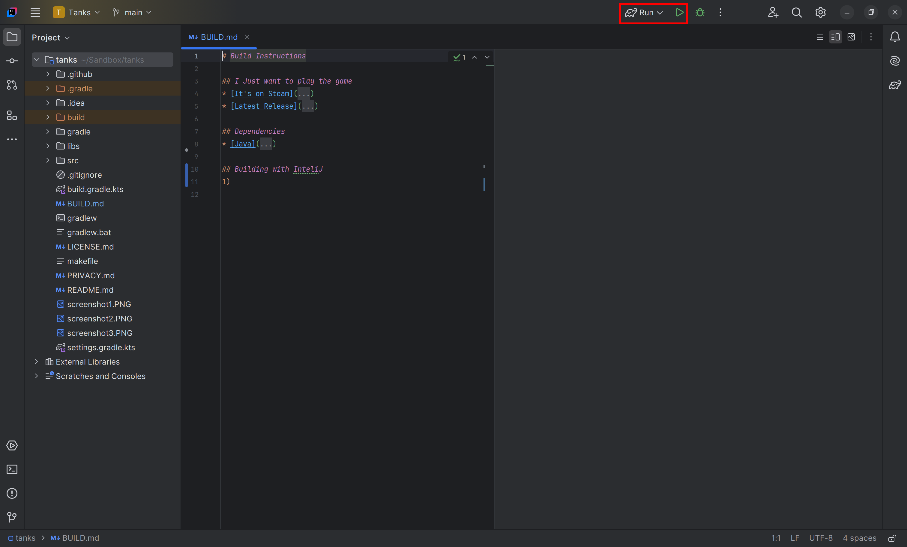

# Build Instructions

## I Just want to play the game
* [It's on Steam](https://store.steampowered.com/app/1660910/Tanks_The_Crusades/)
* [Latest Release](https://github.com/aehmttw/tanks/releases)

## Dependencies
* [Java](https://www.java.com/en/)
* [Git](https://git-scm.com/)

## Clone the Repo:
In a directory of your choice run `git clone https://github.com/aehmttw/tanks.git`

## Building with InteliJ
Open the Tanks directory created by the clone command in InteliJ

Make sure the Run Action is selected and hit the play button.

A Build Action is also available in the menu.

## Building on MacOS/Linux/Windows
Within the Tanks directory created by the clone command run one of the following commands:

Build: `./gradlew clean build`

Run: `./gradlew clean build run`

## Network and compact-save validation

The game targets Java 8. Use a Java 8 `JAVA_HOME` when running `./gradlew test lint`
to verify compatibility with the minimum runtime. Zstandard uses
`com.github.luben:zstd-jni:1.5.7-6`, whose Java classes target Java 8. Its desktop
native libraries are included in the game JAR; do not relocate its classes.

Implementation boundaries:

- `tanks.compression.CompressionCodec` and `ZstdCompression` operate on byte arrays,
  with no dependency on Netty, game settings or files.
- `NetworkFrameCodec` owns framing, compression thresholds and size limits.
  `EventObjectBuffer` turns every event into an ObjectBuffer, including custom events.
  `NetworkMessage` connects encoding and framing to event registration and statistics.
  TCP, Steam and Tanks Online call the same entry points.
- `TanksONDocument` converts embedded objects for both network and disk storage.
- `TanksSaveCodec` owns the save header and text/compact detection using streams.
  `TanksFile` handles filesystem I/O and atomic replacement; `TanksFileManager`
  selects it for `.tanks` files. The desktop launchers inject the debug preference
  as a Java 8 `BooleanSupplier`, leaving `basewindow` independent of game formats.

Changing the compression implementation used by a network peer still requires
a matching wire protocol. These boundaries allow reuse and isolated tests, not
automatic negotiation of arbitrary compression algorithms.

Protocol 66 uses shared framing for TCP, Steam and Tanks Online. An uncompressed
frame is `[body length << 1: varint][ObjectBuffer event]`. The event ObjectBuffer is a
list: numeric event id, an optional packed float array, then typed fields in a
fixed order. The network protocol supplies the ObjectBuffer version and property
table, so common network buffers use a one-byte marker instead of the full
ObjectBuffer header. Events with extension property ids retain the full header
and addendum. Saved files always retain the full versioned header; readers still
accept earlier ObjectBuffer versions. For bodies of at least
256 bytes, the sender tries Zstandard level 4 and keeps it only when smaller,
including the extra header. A compressed frame is
`[(payload length << 1) | 1: varint][decoded length: varint][Zstandard frame]`,
where payload length includes the decoded-length varint.
Both encoded and decoded lengths are bounded by the existing event-size limit.
Handshakes and rejection messages also use ObjectBuffers. Peers running earlier
protocols cannot decode protocol 66 frames. UUID fields are two longs inside the
ObjectBuffer. Bandwidth counters measure the encoded frame sizes.

Fields marked `@NetworkTanksON` embed parsed TanksON document parts directly in
the event ObjectBuffer. Other fields are encoded as typed ObjectBuffer values.
Level layout text and section headers are preserved, and legacy object schema
versions are retained. Object formatting is normalized on decoding. Plain
strings such as chat and player names remain literal UTF-8.

The debug menu's **Reduced disk space** option defaults off and persists in
options. On desktop, newly written `.tanks` files use ObjectBuffers when smaller;
existing saves are not rewritten automatically. Both text and compact saves are
read regardless of the option. Turning the option off and saving again produces
text. Compact saves start with `TKOB`, version byte `1`, compression byte `0`,
then an ObjectBuffer document. Compression byte `1` is reserved for Zstandard;
disk compression is not implemented and its debug-menu entry is disabled.
Older game builds cannot read compact saves.

The debug menu's **Network Zstandard** option defaults on and persists as
`network_compression`. Turning it off skips compression for outbound frames;
ObjectBuffer encoding and wire framing stay the same. Receivers accept both raw
and compressed frames, so peers may use different settings without a protocol
change. This is intended for testing CPU versus bandwidth on fast networks.

Run `./gradlew build benchmarkNetworkWire` with a Java 8 `JAVA_HOME` for a direct
event-wire comparison. It writes `build/reports/network-wire.csv` and prints the
same results in the terminal. It uses
the same event objects for four encodings: the previous `event.write(ByteBuf)`
format, that format plus level-4 Zstandard, ObjectBuffer events, and the current
ObjectBuffer plus level-4 Zstandard path. The CSV output includes each 4-byte
frame length prefix, a per-scenario total, and indicative encoding times in the terminal. Scenarios
include 1,000 tank updates, 100 ping/chat pairs, setup/custom events, and share
and upload events for all 13 levels in `Tests.zip`. Negative change percentages
mean fewer bytes. The legacy writer is retained in the benchmark as the
historical comparison; it is no longer used by network transports.

Run `./gradlew benchmarkNetwork` for the separate level-document payload
comparison. Both benchmarks use synthetic event sequences and bundled level
fixtures; neither includes TCP/IP or Steam packet overhead or represents a live
session trace.

Run `./gradlew benchmarkNetworkZstd` with a Java 8 `JAVA_HOME` to compare the
current network path with Zstandard on and off. It writes
`build/reports/network-zstd.csv`, including frame bytes and indicative median
encode/decode times on the same preconstructed events. Compression is only
attempted for event bodies of at least 256 bytes. It also writes
`build/reports/network-zstd-framing.csv`, which times framing alone on
pre-serialized ObjectBuffer event bodies to isolate Zstandard's cost.
